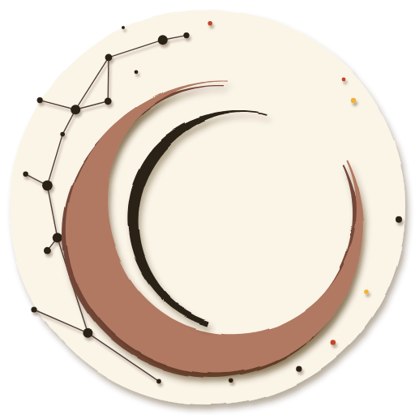
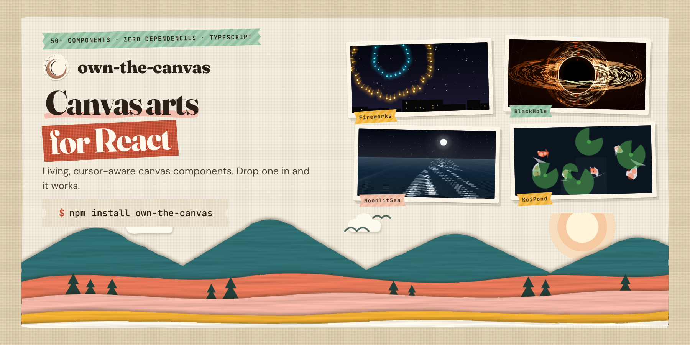

<p align="left">
  
</p>

# own-the-canvas

**50+ canvas-based React visual components. Zero dependencies. TypeScript.**

[](https://www.npmjs.com/package/own-the-canvas)
[](LICENSE)
[](https://www.typescriptlang.org)
[](https://www.npmjs.com/package/own-the-canvas)
[](https://react.dev)



---

## What's New in 2.0

- **Living Scenes:** nature effects with real models underneath, from ivy that grows along your headline to fireflies that flash in sync and a moonlit sea that glitters where the waves catch the moon.
- **Effects that know your page:** mark any element with `data-otc-solid` and petals, snow, seeds, leaves, fireflies, and paper cranes land on it, and ivy climbs it.
- **Color by default:** every component opens in its signature palette. Pass `preset="monochrome"` for the 1.x look.
- **Production-safe runtime:** effects pause offscreen and in background tabs, respect `prefers-reduced-motion`, and run at the same speed on 60Hz and 120Hz screens.
- **Rebuilt classics:** DragonCursor, Fireworks, Rain, BlackHole, TornadoVortex, SolarFlare, Boids, and more were redrawn from scratch with the same props.

Upgrading from 1.x? See [Upgrading from 1.x](#upgrading-from-1x).

---

## Install

```bash
npm install own-the-canvas
# or
pnpm add own-the-canvas
# or
yarn add own-the-canvas
```

> **Peer deps:** React 18 or 19

---

## Quick Start

Every component fills its parent container by default. Drop it in and it works.

```tsx
import { MatrixRain } from "own-the-canvas";

export default function App() {
  return (
    <div style={{ width: "100vw", height: "100vh" }}>
      <MatrixRain preset="cyberpunk" />
    </div>
  );
}
```

All components accept a `preset` prop for instant themed defaults — override any individual prop on top.

---

## Effects That Know Your Page

Mark any element with `data-otc-solid` and effects collide with it. Petals land on your headline, rest on your buttons, and slide off the edges in the wind. Resting petals stay attached when the page scrolls.

```tsx
import { SakuraBlossom } from "own-the-canvas";

<SakuraBlossom overlay collide preset="sakura" />

<h1 data-otc-solid>Ship faster</h1>
<button data-otc-solid>Get started</button>
```

| Prop | Type | Default | Description |
| --- | --- | --- | --- |
| `overlay` | `boolean` | `false` | Fixed full-viewport layer over the page, click-through, transparent background |
| `collide` | `boolean` | `false` | Collide with `[data-otc-solid]` elements |
| `restitution` | `number` | `0` | `0` = rest and slide off, `> 0` = bounce |
| `zIndex` | `number` | `10` | Overlay stacking order |

Use `data-otc-solid="live"` for sticky or animated elements so their position is re-read every frame.

What each DOM-aware effect does with marked elements:

| Component | With `collide` |
| --- | --- |
| `SakuraBlossom` | Petals land, rest, and slide off in the wind |
| `IvyGrowth` | Vines climb each element's sides and grow across its top |
| `Fireflies` | Fireflies perch on top edges and blink there |
| `Dandelion` | Blown seeds parachute down and settle on elements |
| `PaperLanterns` | Clicking a marked element releases a lantern from it |
| `SnowDrift` | Snow piles up on top edges and spills off the sides |
| `FrostGlass` | Frost nucleates on element edges and grows outward |
| `OrigamiCranes` | Paper cranes land and rest with wings folded |
| `SeasonsTree` | Falling autumn leaves and petals settle on elements |

Rain and Confetti are next.

---

## Production-Safe by Default

Runtime-based components (SakuraBlossom, the Living Scenes below, and the rebuilt TornadoVortex, SolarFlare, BlackHole, NoiseGradient, Boids, and WatercolorBloom) get these behaviors with no setup:

- **Pause offscreen:** zero work while scrolled out of view.
- **Pause in background tabs:** resumes without a burst of catch-up motion.
- **Respects `prefers-reduced-motion`:** renders one still frame and stops.
- **Adaptive quality:** particle budget drops when frames run slow and recovers when they don't.
- **Same speed on every display:** motion is time-based, so 120Hz screens don't run 2x fast.
- **DPR capped at 2:** sharp on retina without 3x-density cost on phones.
- **SSR-safe:** overlay canvases mount on the client only.

---

## Featured Components

### DragonCursor

A glowing dragon that follows your cursor: a tapered, scaled body with dorsal spines, membrane wings, a horned head with glowing eyes, and fire breath. When the cursor leaves the canvas it wanders on its own over a star field.

**Presets:** `default · emerald · inferno · void · ice · monochrome`

```tsx
import { DragonCursor } from "own-the-canvas";

<DragonCursor preset="inferno" segmentCount={24} showFire wingSpan={70} starCount={80} glowingStars />
```

| Prop | Type | Default | Description |
| --- | --- | --- | --- |
| `segmentCount` | `number` | `20` | Body segment count |
| `bodyColor` | `string` | `"#35e0a1"` | Dragon body color |
| `wingSpan` | `number` | `80` | Wing span in px |
| `showFire` | `boolean` | `false` | Enable fire breath |
| `followSpeed` | `number` | `0.15` | Cursor follow lerp speed |
| `starCount` | `number` | `60` | Number of background stars |
| `starColor` | `string` | `"#ffffff"` | Star color |
| `glowingStars` | `boolean` | `false` | Layered halo glow on ~28% of stars |
| `starGlowBlur` | `number` | `8` | Glow blur radius for glowing stars |

---

### MatrixRain

Falling character rain — katakana, latin, or binary. Per-column trail fade, variable speed, neon green or any color.

**Presets:** `default · cyberpunk · binary · minimal · blood · monochrome`

```tsx
import { MatrixRain } from "own-the-canvas";

<MatrixRain color="#00ff41" charset="katakana" fontSize={16} speed={20} />
```

| Prop | Type | Default | Description |
| --- | --- | --- | --- |
| `color` | `string` | `"#00ff41"` | Character color |
| `charset` | `"latin" \| "binary" \| "katakana" \| string` | `"latin"` | Character set |
| `fontSize` | `number` | `14` | Font size in px |
| `speed` | `number` | `33` | Ms per frame — lower = faster |
| `backgroundColor` | `string` | `"rgba(17,17,17,0.1)"` | Per-frame overlay — controls trail length |

---

### KoiPond

Living koi pond on canvas — fish navigate with organic steering, ripple on hover, lily pads float, caustic light dances.

**Presets:** `default · koi · night · lotus · neon · monochrome`

```tsx
import { KoiPond } from "own-the-canvas";

<KoiPond preset="koi" fishCount={8} interactive showLilies caustics />
```

| Prop | Type | Default | Description |
| --- | --- | --- | --- |
| `fishCount` | `number` | `6` | Number of koi fish |
| `fishColor` | `string` | `"#ff6030"` | Fish body color |
| `showLilies` | `boolean` | `true` | Render floating lily pads |
| `caustics` | `boolean` | `true` | Caustic light shimmer |
| `interactive` | `boolean` | `true` | React to mouse movement |

---

### FluidSimulation

Real-time Navier-Stokes fluid solver. Move your mouse to inject velocity and ink — auto-bursts fire at intervals for continuous motion.

**Presets:** `default · ink · neon · lava · ocean · smoke · monochrome`

```tsx
import { FluidSimulation } from "own-the-canvas";

<FluidSimulation
  preset="neon"
  inkColors={["#ff00ff", "#00ffff", "#7700ff"]}
  resolution={80}
/>
```

| Prop | Type | Default | Description |
| --- | --- | --- | --- |
| `resolution` | `number` | `80` | Grid resolution 32–128 |
| `inkColors` | `string[]` | `["#0c4a6e", "#0891B2", "#06b6d4", "#67e8f9"]` | Ink colors |
| `viscosity` | `number` | `0.0001` | Fluid viscosity |
| `autoInk` | `boolean` | `true` | Auto-inject ink bursts |
| `mouseForce` | `number` | `5` | Mouse velocity force multiplier |

---

### FlowField

Perlin noise vector field guiding 800 particle streams. Enable `curl` for swirling, organic motion. Builds layered ink-like compositions over time.

**Presets:** `default · neon · ocean · lava · forest · monochrome`

```tsx
import { FlowField } from "own-the-canvas";

<FlowField
  preset="ocean"
  particleCount={1200}
  curl
  noiseScale={0.003}
/>
```

| Prop | Type | Default | Description |
| --- | --- | --- | --- |
| `particleCount` | `number` | `800` | Number of flow particles |
| `colors` | `string[]` | `["#0c4a6e", "#0891B2", "#06b6d4", "#67e8f9", "#e0f2fe"]` | Particle stroke colors |
| `noiseScale` | `number` | `0.004` | Noise scale — lower = larger structures |
| `curl` | `boolean` | `false` | Add curl noise for swirling flow |
| `speed` | `number` | `1` | Flow speed multiplier |

---

### BubbleUniverse

Soap bubbles with real thin-film color: clear centers, swirling rainbow rims, and window reflections. They drift upward over soft bokeh, merge on contact, and pop on click.

**Presets:** `default · soap · neon · deep · minimal · monochrome`

```tsx
import { BubbleUniverse } from "own-the-canvas";

<BubbleUniverse preset="soap" bubbleCount={20} mergeOnCollide glowEffect />
```

| Prop | Type | Default | Description |
| --- | --- | --- | --- |
| `bubbleCount` | `number` | `15` | Number of bubbles |
| `mergeOnCollide` | `boolean` | `true` | Bubbles merge on collision |
| `popEffect` | `boolean` | `true` | Pop animation on click |
| `glowEffect` | `boolean` | `true` | Glow on bubbles |
| `gravity` | `number` | `0.02` | Gravity strength |

---

### Rain

A rainy night street: three depth layers of rain in a gusting wind, mist, street lamps mirrored on wet asphalt, ripples and spray, and lightning flashes when the rain is heavy.

**Presets:** `default · storm · drizzle · neon · golden · monochrome`

```tsx
import { Rain } from "own-the-canvas";

<Rain preset="storm" dropCount={400} wind={0.6} showSplashes starCount={60} glowingStars />
```

| Prop | Type | Default | Description |
| --- | --- | --- | --- |
| `dropCount` | `number` | `200` | Number of rain drops |
| `speed` | `number` | `15` | Drop fall speed px/frame |
| `wind` | `number` | `0.3` | Horizontal wind drift |
| `dropColor` | `string` | `"#a9c2e8"` | Drop stroke color |
| `showSplashes` | `boolean` | `true` | Splash particles on impact |
| `starCount` | `number` | `60` | Number of background stars |
| `starColor` | `string` | `"#ffffff"` | Star color |
| `glowingStars` | `boolean` | `false` | Layered halo glow on ~28% of stars |
| `starGlowBlur` | `number` | `8` | Glow blur radius for glowing stars |

---

### FireEffect

Licking flame tongues from a smooth noise-driven heat field, with a soft glow and sparks rising off the top. Five colour palettes, wind, and flame height controls.

**Presets:** `default · inferno · toxic · ice · plasma · monochrome`

```tsx
import { FireEffect } from "own-the-canvas";

<FireEffect palette="inferno" intensity={0.95} windStrength={0.4} />
```

| Prop | Type | Default | Description |
| --- | --- | --- | --- |
| `palette` | `"smoke" \| "inferno" \| "toxic" \| "ice" \| "plasma"` | `"inferno"` | Color theme |
| `customColors` | `string[]` | `undefined` | Custom gradient — overrides palette when ≥2 colors |
| `intensity` | `number` | `0.95` | Flame intensity 0–1 |
| `windStrength` | `number` | `0.3` | Horizontal wind -1 to 1 |
| `cooling` | `number` | `0.3` | Cooling rate — higher = shorter flames |
| `spread` | `number` | `0` | Flame spread 0–1 |

---

## Base Props

Every component accepts these props:

| Prop | Type | Default | Description |
| --- | --- | --- | --- |
| `width` | `number \| string` | `"100%"` | Container width |
| `height` | `number \| string` | `"100%"` | Container height |
| `className` | `string` | — | CSS class on wrapper `<div>` |
| `style` | `React.CSSProperties` | — | Inline styles on wrapper `<div>` |
| `preset` | `string` | `"default"` | Named preset that sets themed defaults. `"monochrome"` gives the 1.x grayscale look |

All components use `forwardRef` — the ref is forwarded to the underlying `<canvas>` element.

---

## Living Scenes

Nature effects with real models underneath, built for hero sections. Each one runs on the shared runtime, and the ones marked ✦ react to `data-otc-solid` elements.

| Component | What you see |
| --- | --- |
| `IvyGrowth` ✦ | Ivy that grows in real time and climbs the edges of your elements (space colonization) |
| `Fireflies` ✦ | Fireflies whose flashing slowly falls into sync, perching on your elements |
| `Dandelion` ✦ | Dandelion clocks you blow apart with the cursor; seeds parachute down on the wind |
| `GrassField` | Grass on springs that sways in rolling gusts and parts around the cursor |
| `Moths` | Moths spiraling a lamp by transverse orientation; your cursor is the light |
| `SunbeamDust` | Window light shafts where dust only glitters inside the beams |
| `PaperLanterns` ✦ | Sky lanterns rising with depth and flicker; click a button to release one from it |
| `KelpForest` | Swaying kelp, schooling fish, and surface light; the cursor pushes the water |
| `SnowDrift` ✦ | Snow that piles up on your headline and buttons, then slides off the edges |
| `FrostGlass` ✦ | Frost crystals creep across the glass; the cursor is warm breath that melts them |
| `OrigamiCranes` ✦ | Faceted paper cranes in 3D that bank, flap, and land on your elements |
| `SeasonsTree` ✦ | A swaying tree living through spring, summer, autumn, and winter |
| `InkMountains` | Ink-wash ridgelines dissolving into drifting mist, with parallax |
| `WindowRain` | Rain running down a fogged window over blurred city lights; drag to wipe |
| `IncenseSmoke` | A thread of incense smoke that breaks into curls as it rises |
| `MoonlitSea` | Night swells with a glittering moon path and cursor ripples |
| `CloudSea` | A sunset cloud deck seen from above that parts under the cursor |
| `Ferrofluid` | Glossy ferrofluid that spikes toward the cursor like a magnet |

---

## More Components

> AntColony · AuroraBorealis · BlackHole · Boids · ButterflySwarm · Confetti · CrystalGrowth · DeepSeaBioluminescence · DiffusionAggregation · Fireworks · GalaxySpiral · GameOfLife · Kaleidoscope · LSystem · Lightning · MagneticField · Mandala · Metaballs · NeuralWeb · NoiseGradient · ParticleField · PendulaWave · ReactionDiffusion · SakuraBlossom · SandSimulation · SlimeMold · SolarFlare · SpiderWeb · Spirograph · Starfield · TornadoVortex · VoronoiCells · WatercolorBloom · WaveInterference

Full docs, live previews, and interactive playground:

**[own-the-canvas.vercel.app](https://own-the-canvas.vercel.app)**

---

## Upgrading from 1.x

2.0 removes 11 components and changes default colors. Everything else keeps its props.

| Removed in 2.0 | Use instead |
| --- | --- |
| `Lissajous` | `PendulaWave` (its harmonograph draws the same figures) |
| `MagneticBlob` | `Metaballs` |
| `Wormhole` | `Starfield` with `perspective="3D"` |
| `Shockwave`, `ClothSimulation`, `GlitchOverlay`, `PixelDissolve`, `AudioVisualizer`, `TerrainMesh`, `ParticleText`, `InkBleed` | No direct replacement. Stay on 1.0.12 if you need them |

**Default colors changed.** With no `preset`, components now render in color. To keep the 1.x look, pass `preset="monochrome"`. Explicit color props still override any preset.

**Cursor effects stay inside their canvas.** Effects that follow the cursor now ignore it when it's outside their canvas, instead of chasing it across the page.

---

## License

MIT
